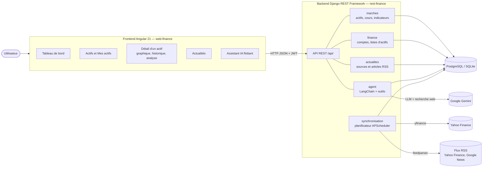

# MEFA — Tableau de bord de volatilité des marchés financiers

MEFA suit un panier d'actifs financiers (actions, indices, cryptomonnaies), calcule des indicateurs de volatilité
(écart-type glissant, amplitude, rendement, corrélation, covariance), repère les mouvements inhabituels et les fait
expliquer par un agent IA à partir des actualités de la période.

Projet 2 du catalogue « Développement Web en Python » (Master 2 Data Science).

- **Backend :** Django 6.1 + Django REST Framework, authentification JWT, documentation OpenAPI.
- **Frontend :** Angular 21 + PrimeNG 21, graphiques TradingView Lightweight Charts.
- **Données :** Yahoo Finance (`yfinance`), flux RSS financiers (`feedparser`).
- **Agent :** LangChain (`create_agent`, sur LangGraph) + Google Gemini (`gemini-2.5-flash`).
- **Base :** SQLite par défaut, PostgreSQL recommandé (voir [PostgreSQL](#postgresql)).

---

## Sommaire

1. [Fonctionnalités](#fonctionnalités)
2. [Architecture](#architecture)
3. [Installation](#installation)
4. [Premier lancement](#premier-lancement)
5. [Commandes de gestion](#commandes-de-gestion)
6. [API](#api)
7. [Agent IA](#agent-ia)
8. [Tests](#tests)
9. [Structure du dépôt](#structure-du-dépôt)
10. [Répartition des rôles](#répartition-des-rôles)

---

## Fonctionnalités

| Exigence du projet 2 | Réalisation |
|---|---|
| Panier d'actifs : actions, indices, cryptomonnaies | AAPL, MSFT, TSLA · S&P 500 (`^GSPC`), CAC 40 (`^FCHI`) · BTC-USD, ETH-USD. Tout autre symbole Yahoo peut être ajouté depuis l'interface. |
| Modèles `Actif` et `CoursHistorique` (OHLCV horodaté) | `marches.models` : `Actif`, `CoursHistorique`, `CoursJournalier`, `IndicateurJournalier` |
| Tâche d'ingestion périodique | Commande `lancer_planificateur` (APScheduler) : cours toutes les 5 min, import journalier toutes les 5 h, RSS toutes les heures |
| API : séries temporelles filtrables par actif et par période | `GET /api/cours/?actif=AAPL&debut=…&fin=…` (paginée) |
| Graphiques de cours et de volatilité glissante | Page détail d'un actif : chandeliers, volume, MM20/MM50, échelle log, écart-type glissant |
| Comparaison entre actifs | Base 100, performances, volatilité, écart à la référence, sens d'évolution |
| Corrélations (et covariances) | Matrice de corrélation et de covariance des rendements |
| Mouvements inhabituels | Pics détectés par score Z, marqueurs sur le graphique, notifications |
| Agent : explication d'un pic avec les actualités (RSS) | Articles de la période via le flux RSS de Google News, puis explication sourcée par Gemini |

Autres écrans : tableau de bord, liste et recherche des actifs, listes d'actifs personnelles (« Mes actifs »),
actualités RSS, assistant conversationnel, inscription, connexion et profil.

---

## Architecture



### Applications Django (`rest-finance/`)

| Application | Rôle |
|---|---|
| `config` | Réglages, routes racine, documentation OpenAPI |
| `finance` | Utilisateur personnalisé, authentification JWT (inscription, connexion, jeton de rafraîchissement en cookie, profil, mot de passe), listes d'actifs de l'utilisateur |
| `marches` | Actifs, cours horaires et journaliers, calculs de volatilité (`indicateurs.py`), indicateurs journaliers et pics (`journalier.py`), corrélations |
| `actualites` | Sources RSS, collecte des articles (`services/rss_collector.py`), rattachement des articles aux pics |
| `agent` | Explication des pics par Gemini, agent conversationnel LangChain avec ses outils, mémoire des échanges |
| `synchronisation` | Import Yahoo Finance et planificateur des tâches périodiques |

### Flux des données

1. **Ingestion :** `lancer_planificateur` importe les cours Yahoo Finance (horaires et journaliers) et les articles RSS.
2. **Calcul :** `calculer_indicateurs` calcule pour chaque jour le rendement, la volatilité, le score Z, le volume anormal,
   le gap d'ouverture et le bêta, puis marque les pics (systémiques ou spécifiques).
3. **Contexte :** `collecter_articles_pics` cherche sur Google News (RSS) les articles publiés autour de chaque pic.
4. **Explication :** l'agent combine les indicateurs et les articles, et Gemini rédige une explication plausible avec ses sources.
5. **Affichage :** Angular interroge l'API ; l'utilisateur peut cliquer sur un point du graphique pour obtenir l'explication
   ou interroger l'assistant.

Le dossier `diagramme/` contient le diagramme de cas d'utilisation.

---

## Installation

### Prérequis

- Python **3.12 ou plus** (exigé par Django 6.1)
- Node.js **20.19 ou plus** (ou 22.12+), avec npm
- Optionnel : PostgreSQL 15 ou plus (minimum de Django 6.1)
- Une clé Gemini gratuite pour l'agent : <https://aistudio.google.com/apikey>

### 1. Backend

```bash
cd rest-finance
python -m venv .venv
# Windows : .venv\Scripts\activate    —    macOS / Linux : source .venv/bin/activate
pip install -r requirements.txt
cp .env.example .env        # Windows : copy .env.example .env
```

Renseignez au minimum `GOOGLE_API_KEY` dans `.env`. Les autres variables sont décrites dans `.env.example` :

| Variable | Rôle | Par défaut |
|---|---|---|
| `GOOGLE_API_KEY` | Clé Gemini de l'agent IA | — (l'agent répond « indisponible » sans elle) |
| `POSTGRES_DB`, `POSTGRES_USER`, `POSTGRES_PASSWORD`, `POSTGRES_HOST`, `POSTGRES_PORT` | Connexion PostgreSQL | SQLite si `POSTGRES_DB` est vide |
| `DJANGO_SECRET_KEY` | Clé secrète en production | Clé de développement |
| `DJANGO_DEBUG` | Mode debug | `True` |
| `DJANGO_ALLOWED_HOSTS` | Hôtes autorisés, séparés par des virgules | Vide (localhost en debug) |

Puis créez la base :

```bash
python manage.py migrate
```

### PostgreSQL

Sans configuration, Django utilise `rest-finance/db.sqlite3`. Pour PostgreSQL :

```bash
createdb mefa            # ou : psql -U postgres -c "CREATE DATABASE mefa;"
```

Dans `.env` :

```ini
POSTGRES_DB=mefa
POSTGRES_USER=postgres
POSTGRES_PASSWORD=votre-mot-de-passe
POSTGRES_HOST=localhost
POSTGRES_PORT=5432
```

Puis relancez `python manage.py migrate`.

### 2. Frontend

```bash
cd web-finance
npm ci
```

L'adresse de l'API est dans `web-finance/src/environments/environment.ts` (`http://localhost:8000/api` par défaut).

---

## Premier lancement

Ouvrez trois terminaux.

**Terminal 1 — données (backend, environnement virtuel activé) :**

```bash
cd rest-finance
python manage.py lancer_planificateur
```

Au démarrage, il charge le panier d'actifs, importe un an de cours, calcule les indicateurs, collecte les articles des pics
et les flux RSS, puis recommence périodiquement. Laissez-le tourner.

**Terminal 2 — API :**

```bash
cd rest-finance
python manage.py runserver
```

**Terminal 3 — interface :**

```bash
cd web-finance
npm start
```

Ouvrez <http://localhost:4200>, créez un compte avec **Inscription**, puis connectez-vous.

> Sans le planificateur, vous pouvez remplir la base à la main :
>
> ```bash
> python manage.py charger_actifs
> python manage.py importer_cours AAPL MSFT TSLA --indice "^GSPC"
> python manage.py importer_cours "^FCHI" --type indice
> python manage.py importer_cours BTC-USD ETH-USD --type crypto
> python manage.py synchroniser_yahoo
> python manage.py calculer_indicateurs
> python manage.py configurer_sources_yahoo
> python manage.py collecter_rss
> python manage.py collecter_articles_pics
> ```

---

## Commandes de gestion

| Commande | Rôle |
|---|---|
| `lancer_planificateur` | Lance toutes les tâches d'ingestion, puis les répète (5 min, 1 h, 5 h) |
| `charger_actifs` | Insère le panier d'actifs de départ |
| `importer_cours TICKERS [--type] [--indice] [--periode 1y]` | Importe les cours journaliers depuis Yahoo Finance |
| `synchroniser_yahoo` | Met à jour les cours récents des actifs suivis |
| `ingerer_cours [--symbole …]` | Télécharge les cours toutes les 5 minutes des actifs suivis |
| `etat_cours` | Affiche le nombre de bougies et la période couverte par actif |
| `calculer_indicateurs [TICKERS]` | Calcule les indicateurs journaliers et repère les pics |
| `preparer_actifs_portefeuilles` | Importe et analyse les actifs ajoutés par les utilisateurs |
| `configurer_sources_yahoo` | Crée une source RSS Yahoo Finance par actif suivi |
| `collecter_rss` | Collecte les articles des flux RSS actifs |
| `collecter_articles_pics` | Cherche sur Google News les articles des pics qui n'en ont pas |

Toutes se lancent avec `python manage.py <commande>` depuis `rest-finance/`.

---

## API

Documentation interactive, serveur lancé :

- Swagger : <http://localhost:8000/api/docs/>
- ReDoc : <http://localhost:8000/api/redoc/>
- Schéma OpenAPI : <http://localhost:8000/api/schema/>

Toutes les routes, sauf l'inscription et la connexion, exigent un jeton JWT (`Authorization: Bearer <jeton>`).

| Domaine | Routes principales |
|---|---|
| Authentification | `POST /api/auth/inscription/`, `/connexion/`, `/rafraichir/`, `/deconnexion/` · `GET/PATCH /api/auth/profile/` · `POST /api/auth/mot-de-passe/` |
| Actifs | `GET /api/actifs/` (filtres `type_actif`, `search`) · `GET /api/actifs/{symbole}/` |
| Cours | `GET /api/cours/?actif=AAPL&debut=2026-10-01T00:00:00Z&fin=2026-10-31T23:59:59Z` (paginé) |
| Volatilité et pics | `GET /api/actifs/{symbole}/volatilite/` · `GET /api/actifs/{symbole}/pics/` · `GET /api/pics-journaliers/?symbole=AAPL&debut=…` |
| Corrélations | `GET /api/correlations/?actifs=AAPL,MSFT,BTC-USD` (2 à 10 actifs) |
| Actualités | `GET /api/actualites/` · `GET /api/sources/` |
| Listes d'actifs | `GET/POST /api/portefeuilles/` · `GET/PUT/PATCH/DELETE /api/portefeuilles/{id}/` · `POST /api/portefeuilles/{id}/actifs/` |
| Agent | `GET /api/agent/pics/{symbole}/{jour}/explication/` · `POST /api/assistant-ia/question/` · `GET /api/assistant-ia/historique/` |

---

## Agent IA

Deux usages, dans l'application `agent` :

1. **Explication d'un pic** (`ExplicationPicView`) : à partir des indicateurs du jour et des articles RSS de la période,
   Gemini rédige une explication en cinq phrases au plus, avec ses sources. Elle est enregistrée en base et réutilisée.
2. **Assistant conversationnel** (`graphe.py`) : un agent LangChain qui choisit et appelle ses outils (`outils.py`) :

| Outil | Rôle |
|---|---|
| `lister_pics` | Pics de volatilité d'un actif sur une période |
| `indicateurs_du_jour` | Variation, volatilité annualisée, score Z, volume anormal, gap, bêta d'un jour |
| `expliquer_un_pic` | Explication sourcée d'un pic |
| `cours_autour_d_une_heure` | Bougies horaires autour d'un moment précis (clic sur le graphique) |

L'agent connaît les listes d'actifs de l'utilisateur et garde un résumé des échanges anciens (`memoire.py`).
Il explique le risque et les points à surveiller, mais ne recommande jamais d'acheter ou de vendre.

Depuis le graphique, un clic sur une bougie ouvre l'explication du jour ; le bouton **Demander à l'assistant** lui
transmet le moment, la bougie et l'explication pour une analyse détaillée.

### Analyse croisée (frontend)

Le bouton **Analyse croisée** de la page détail (dernier jour, ou jour cliqué sur le graphique) est calculé dans le
navigateur par `AnalyseCroiseeService` (`web-finance/src/app/pages/service/service/analyse-croisee.service.ts`), sans
route dédiée : il lit les routes existantes (actif, volatilité de l'actif et de son indice, pics journaliers,
corrélations, actualités, listes de l'utilisateur) puis `croiserInformations()` en déduit le mouvement du jour et son
score Z, le régime de volatilité, le lien avec le marché, les actifs liés ou diversifiants, les articles de la période,
l'exposition des listes, un niveau de risque et des conseils de lecture du risque. L'explication de Gemini peut y être
ajoutée, et l'analyse peut être transmise à l'assistant pour l'approfondir.

---

## Tests

```bash
# Backend (depuis rest-finance/, environnement activé)
python manage.py test

# Frontend (depuis web-finance/)
npm test -- --watch=false
npm run build            # build de production
```

Le backend compte 110 tests (API, calcul des indicateurs, pics journaliers, agent, listes d'actifs).
Ils passent sur SQLite et sur PostgreSQL.

---

## Structure du dépôt

```text
.
├── diagramme/                  Diagramme de cas d'utilisation
├── rest-finance/               Backend Django REST Framework
│   ├── config/                 Réglages et routes
│   ├── finance/                Comptes et listes d'actifs
│   ├── marches/                Actifs, cours, indicateurs, pics
│   ├── actualites/             Sources et articles RSS
│   ├── agent/                  Agent IA (Gemini, LangChain)
│   ├── synchronisation/        Import Yahoo Finance et planificateur
│   ├── requirements.txt
│   └── .env.example
└── web-finance/                Frontend Angular
    └── src/app/
        ├── layout/             Barre supérieure, menu, pied de page
        ├── models/             Types TypeScript de l'API
        └── pages/              Tableau de bord, actifs, détail, actualités, authentification, assistant
```

---

## Répartition des rôles

<!-- Répartition établie d'après l'historique Git : à vérifier et compléter par l'équipe. -->

| Membre (compte Git) | Rôle | Principales contributions |
|---|---|---|
| mngono / margotB | Frontend et intégration | Interface Angular : tableau de bord, actifs et listes, détail d'un actif, assistant, authentification ; intégration front-back, actualités |
| yannick.fono | Backend et agent | Moteur d'indicateurs et pics journaliers (`marches`), agent IA (`agent`), API des comptes et des listes (`finance`), configuration |
| yveszogo | Backend | Premier socle Django, modèles et API des marchés, application des portefeuilles |
| AizG237 | Intégration et revue | Revue et fusion des pull requests |
